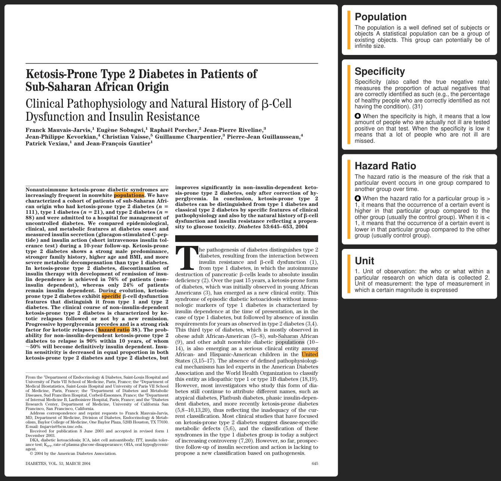

# StatAssist

**Statistical explanations beside the paper you are reading.**

StatAssist is an experimental Python tool that finds statistical terminology in medical articles and adds explanations in a PDF sidebar. It brings definitions closer to the text, so readers can explore unfamiliar methods while reading a paper.

This repository contains the second research prototype, originally developed in 2019. It is preserved as an exploratory project; reproducing the original environment may require dependency and compatibility work.

## See the idea



Preview of the sample output already included in this repository. [Open the full example PDF](outputpdf_name.pdf).

## How it works

1. **Read the article.** Extract words, page numbers and text coordinates from a PDF.
2. **Match terminology.** Compare the article with the search terms and proxy phrases in the statistical guide.
3. **Prepare explanations.** Track where terms first appear and retrieve their explanatory content.
4. **Build the output.** Combine the original article with highlights, explanation cards and links to earlier occurrences.

The matching uses predefined terminology and stemming. It is not a contextual interpretation of the paper, and matches or explanations may need review.

## Explore the repository

| Location | Purpose |
| --- | --- |
| [`src/parser.py`](src/parser.py) | Extract words and their PDF coordinates. |
| [`src/matcher.py`](src/matcher.py) | Match terms and track their occurrences. |
| [`src/translator.py`](src/translator.py) | Organise matches by page and term. |
| [`src/narrator.py`](src/narrator.py) | Prepare the explanation-card content. |
| [`src/painter.py`](src/painter.py) | Lay out the explanation cards. |
| [`src/designer.py`](src/designer.py) | Assemble the annotated PDF and sidebar. |
| [`src/Config.py`](src/Config.py) | Configure input paths, dimensions and colours. |
| [`input/StatGuide.xlsx`](input/StatGuide.xlsx) | Statistical terminology, search phrases and explanations. |
| [`input/example.pdf`](input/example.pdf) | Example input article. |

## Reproducing the prototype

Start with a local copy:

```sh
git clone https://github.com/qpec/StatAssist_V2.git
cd StatAssist_V2
python -m venv .venv
```

Activate the virtual environment using the command for your shell. Before running the prototype:

1. Review the paths in `src/Config.py`. The code expects to run from the repository root.
2. Set up compatible versions of the libraries used by the main pipeline: `pandas`, an Excel reader supported by that version of pandas, `nltk`, `regex`, `Unidecode`, `pdfminer.six`, `reportlab`, `pdfrw` and `PyPDF2`. Helper code also references `PyMuPDF` and `pdfplumber`.
3. Check the output filename construction in `src/designer.py`: it concatenates the configured path and filename directly.

The original entry point is:

```sh
python -m src.designer
```

There is no dependency lockfile or verified setup for current library versions. The source uses legacy PDF APIs, so the command above is an entry-point reference rather than a tested installation recipe. The committed sample PDF is the quickest way to inspect the original result.

## Status and limitations

- **Research prototype:** there is no packaged application or automated test suite in this repository.
- **Terminology matching:** predefined terms can produce false positives or miss context.
- **PDF variability:** extraction, word coordinates and sidebar layout depend on the source document.
- **Historical dependencies:** compatibility with current Python and PDF libraries has not been established here.

For questions about the project, [open an issue](https://github.com/qpec/StatAssist_V2/issues).
